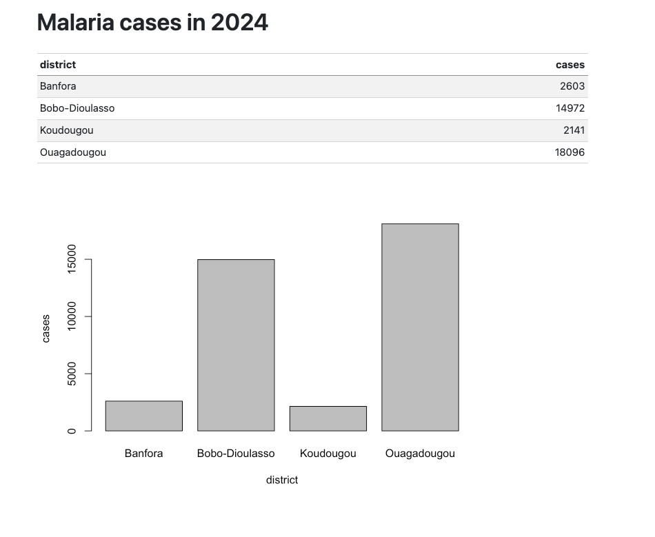

# OpenHexa R SDK

The `openhexa` package is the R client for [OpenHEXA](https://github.com/BLSQ/openhexa): explore workspaces, load data
into data frames, publish web apps and run pipelines in an easy and efficient manner.

In OpenHEXA, data and analyses are organised in **workspaces**, which hold files, versioned **datasets**, a PostgreSQL
**database** with **saved queries**, **pipelines**, **web apps** and **connections** to external systems such as DHIS2
or IASO. The package works with all of them, from an OpenHEXA notebook, from RStudio, or from a script running
anywhere.

## Example

```r
library(openhexa)

# In OpenHEXA notebooks you are already logged in. Elsewhere, either:
# - set HEXA_SERVER_URL, HEXA_TOKEN and HEXA_WORKSPACE (e.g. in ~/.Renviron) and skip login()
# - or pass them, reading the token from an environment variable to keep it out of the script
# - or omit the token in an interactive session, to be prompted for it
login(
  server_url = "https://api.openhexa.org",
  token = Sys.getenv("OPENHEXA_TOKEN"),
  workspace = "malaria-burkina"
)

# Get data as data frames
list_datasets()
cases <- get_dataset_file("routine-data", "cases.parquet")
monthly <- run_saved_query("monthly-malaria-cases")

# Publish a chart as a web app
chart <- plotly::plot_ly(monthly, x = ~month, y = ~cases, type = "bar") # install.packages("plotly")
publish_webapp("Malaria cases", chart)

# Run a pipeline and wait for the result
run_pipeline("dhis2-extract", config = list(start_date = "2024-01-01"), wait = TRUE)
```

## A complete example, with data made in R

This one runs on any workspace where you can write: the data is made in R, then shared in the workspace and read back.

```r
library(openhexa)
login(workspace = "my-workspace") # see the example above

# Some data: monthly malaria cases in four districts, with a peak in the rainy season
set.seed(1)
districts <- data.frame(
  district = c("Bobo-Dioulasso", "Ouagadougou", "Koudougou", "Banfora"),
  population = c(900000, 2500000, 160000, 120000),
  risk = c(1.4, 0.6, 1.1, 1.8)
)
cases <- merge(districts, data.frame(month = seq(as.Date("2024-01-01"), by = "month", length.out = 12)))
season <- 1 + 0.8 * sin((as.integer(format(cases$month, "%m")) - 4) / 6 * pi)
cases$cases <- rpois(nrow(cases), cases$population / 1000 * cases$risk * season)

# Share it in the workspace, as a file and as a versioned dataset
write.csv(cases, "cases.csv", row.names = FALSE)
upload_file("cases.csv", "examples/cases.csv")

dataset <- create_dataset("Example malaria cases")$slug
create_dataset_version(dataset, "2024")
add_dataset_file(dataset, "cases.csv")

# Read it back as a data frame, from anywhere
get_dataset_file(dataset, "cases.csv")

# Publish an interactive chart as a web app, and get its link (install.packages("plotly"))
chart <- plotly::plot_ly(cases, x = ~month, y = ~cases, color = ~district, type = "scatter", mode = "lines")
publish_webapp("Example malaria cases", chart)$url

# Write a Quarto report on the data, render it to a single HTML file and publish it too
# (requires Quarto, https://quarto.org, and install.packages("quarto"))
writeLines(c(
  "---",
  "title: Malaria cases in 2024",
  "format:",
  "  html:",
  "    embed-resources: true",
  "---",
  "",
  "```{r}",
  "#| echo: false",
  "cases <- read.csv('cases.csv')",
  "totals <- aggregate(cases ~ district, cases, sum)",
  "knitr::kable(totals)",
  "barplot(cases ~ district, data = totals)",
  "```"
), "report.qmd")
quarto::quarto_render("report.qmd")
publish_webapp("Malaria report", "report.html")$url
```

The published report:



## Installation

The package is preinstalled in OpenHEXA notebooks. Elsewhere, install the latest release from GitHub:

```r
# install.packages("remotes")
remotes::install_github("BLSQ/openhexa-sdk-r")
```

### Installing a specific version

Releases are tagged on GitHub (`v0.1.0`, `v0.2.0`, ...). R keeps a single version of a package per library, so the
version is chosen when installing:

```r
remotes::install_github("BLSQ/openhexa-sdk-r@v0.2.0")
```

To pin the version for a project, use [renv](https://rstudio.github.io/renv/): it records the version in a lockfile
that restores the same environment on another computer, or in an OpenHEXA workspace.

```r
renv::install("BLSQ/openhexa-sdk-r@v0.2.0")
renv::snapshot()
```

A script can also check the installed version:

```r
stopifnot(packageVersion("openhexa") >= "0.2.0")
```

Versions follow [semantic versioning](https://semver.org). Before 1.0.0, breaking changes increase the minor version
(0.1.x to 0.2.0), so pinning the minor version protects you from them.

## Authenticate and explore

In OpenHEXA notebooks and R notebook pipelines, the package is installed and configured: just call
`library(openhexa)`. Elsewhere, copy your API token from your account settings and log in:

```r
library(openhexa)
login(server_url = "https://api.openhexa.org") # prompts for your API token

list_workspaces()
set_workspace("my-workspace")

list_datasets()
list_files("examples/")
list_saved_queries()
list_webapps()
list_pipelines()
list_connections()

# Every function also takes a workspace, to work with another one without switching
list_datasets(workspace = "other-workspace")
```

## Get data

```r
# A workspace file (CSV, TSV, Parquet, Excel, JSON, RDS), read into a data frame or just downloaded
get_file("examples/cases.csv")
download_file("examples/cases.csv", dest = "cases_copy.csv")

# A dataset, its versions and files
get_dataset(dataset)
list_dataset_versions(dataset)
list_dataset_files(dataset)

# A dataset file, from the latest version or a given one
get_dataset_file(dataset, "cases.csv", version = "2024")

# All the tables of a version, stacked, with a `file` column
get_dataset_data(dataset)

# The workspace database (requires DBI and RPostgres): write a table, then query it
con <- connect_database()
DBI::dbWriteTable(con, "example_cases", cases, overwrite = TRUE)
DBI::dbGetQuery(con, "SELECT district, SUM(cases) AS cases FROM example_cases GROUP BY district")
DBI::dbDisconnect(con)

# Saved queries are written in the Data Studio, e.g. on the table above: run one to get its result
queries <- list_saved_queries()
run_saved_query(queries$slug[1], max_rows = 10000)
```

## Publish a web app

`publish_webapp()` takes a string of HTML, an HTML file, a folder with an `index.html`, or an htmlwidget (plotly,
leaflet, DT, ...), and returns the web app with its `url`:

```r
publish_webapp("Hello", "<h1>Hello from R</h1>")

totals <- aggregate(cases ~ district, cases, sum)
html <- paste0(
  "<h1>Malaria cases in 2024</h1><ul>",
  paste0("<li>", totals$district, ": ", totals$cases, "</li>", collapse = ""),
  "</ul>"
)
app <- publish_webapp("Cases by district", html, public = TRUE)
app$url
```

Publishing again under the same name replaces the content of the web app, so the URL stays the same.

## Create notebooks

```r
create_notebook("examples/malaria.ipynb", c(
  markdown = "# Malaria cases",
  "library(openhexa)",
  sprintf("cases <- get_dataset_file('%s', 'cases.csv')", dataset),
  "summary(cases)"
))
```

## Pipelines and connections

Pipelines are deployed to OpenHEXA, and connections are set up in the workspace settings. From R, you run the
pipelines and read the connections:

```r
code <- list_pipelines()$code[1]
get_pipeline(code) # its parameters, to pass in config, e.g. config = list(start_date = "2024-01-01")

run <- run_pipeline(code, wait = TRUE)
run$status
run$messages
list_pipeline_runs(code)

connection <- list_connections()$identifier[1]
get_connection(connection) # secret values are hidden when printed
```

Inside a pipeline, such as an R notebook pipeline, send messages to the run page with `current_run`, like
`current_run.log_info()` in Python. Outside a pipeline, they are printed in the console.

```r
current_run$log_info("Read ", nrow(cases), " rows")
current_run$log_info("Peak in ", format(cases$month[which.max(cases$cases)], "%B"))
```

## Errors and several servers

Errors have classes (`openhexa_not_found_error`, `openhexa_permission_error`, ...), so they can be handled with
`tryCatch()`, e.g. to create the dataset of the example on the first run only:

```r
dataset <- tryCatch(
  get_dataset("example-malaria-cases")$slug,
  openhexa_not_found_error = function(e) create_dataset("Example malaria cases")$slug
)
```

To work with several servers or tokens in the same session, build clients and pass them as `client`:

```r
demo <- openhexa_client("https://api.demo.openhexa.org", Sys.getenv("OPENHEXA_DEMO_TOKEN"))
list_workspaces(client = demo)
```

## GraphQL escape hatch

For anything else, `graphql_query()` runs any query against the OpenHEXA GraphQL API.

> [!WARNING]
> The GraphQL API is internal to OpenHEXA and **changes without notice**: a query that works today can break after
> the next OpenHEXA release, even if you don't update this package, and semantic versioning doesn't cover it. Use the
> dedicated functions whenever they exist; if you need something they don't do, let the maintainers know and they
> will happily add a function for it. A message recalls this once per session
> (`options(openhexa.quiet_graphql = TRUE)` silences it).

## Development

```sh
make test      # unit tests, with a mocked API
make check     # R CMD check, as in CI
make validate  # check the GraphQL operations against the production schema (Python, graphql-core)
make smoke     # run every tier against the demo server, see tools/smoke_test.R
```

`make smoke` only targets the demo server (https://app.demo.openhexa.org), with a demo API token in
`OPENHEXA_DEMO_TOKEN` and optionally a workspace in `OPENHEXA_DEMO_WORKSPACE`. It is read-only, unless
`OPENHEXA_SMOKE_WRITE=true` (uploads, datasets, web apps, notebooks, prefixed with `smoke-test-`) or
`OPENHEXA_SMOKE_PIPELINE=<code>` (runs that pipeline).

### Testing locally in RStudio

1. Install [R](https://cran.r-project.org) and [RStudio](https://posit.co/download/rstudio-desktop/) (on macOS:
   `brew install r` and `brew install --cask rstudio`).
2. Open the repository as a project: **File → New Project → Existing Directory**, then select the repository folder.
3. Install the development dependencies, once:

   ```r
   install.packages(c("pkgload", "testthat", "withr", "rstudioapi", "shiny", "roxygen2"))
   ```

4. Load the package from source with `pkgload::load_all()` (**Cmd/Ctrl + Shift + L**). Load it again after every
   change; `library(openhexa)` would load the installed version instead.
5. Try it against the demo server. Copy your API token from your account settings on
   [app.demo.openhexa.org](https://app.demo.openhexa.org), then:

   ```r
   login() # opens a dialog: pick "Custom API URL", enter https://api.demo.openhexa.org, then paste the token
   list_workspaces()
   set_workspace("my-workspace")
   list_datasets()
   ```

   To skip the prompts, set `HEXA_SERVER_URL`, `HEXA_TOKEN` and `HEXA_WORKSPACE` in `~/.Renviron`
   (`usethis::edit_r_environ()`), then restart R (**Cmd/Ctrl + Shift + F10**).

6. Run the unit tests with `testthat::test_local()` (**Cmd/Ctrl + Shift + T**), and the demo smoke test with
   `source("tools/smoke_test.R")`, which prompts for a demo token. Restart R first if you logged in by hand.
7. After changing roxygen comments, regenerate the documentation with `roxygen2::roxygenise()`
   (**Cmd/Ctrl + Shift + D**).
